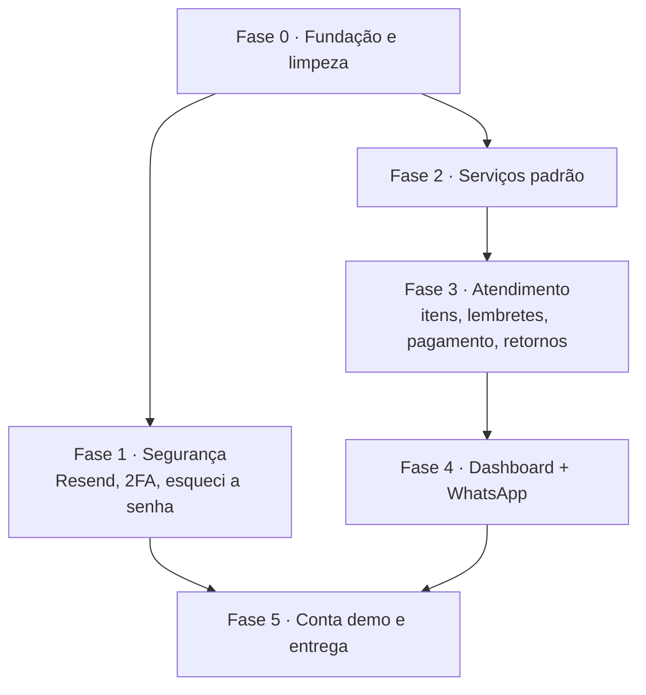

# Plano de evolução — Mecânicos Bike

> Status: **Fases 0 a 5 implementadas no repositório. A validação e o deploy em produção dependem dos acessos e da configuração do ambiente.**
> Data do levantamento: 17/11/2026.

Este diretório registra o escopo e as decisões da evolução do sistema. Consulte o README principal para preparar o banco local e executar a demonstração.

## O que vamos entregar

1. **Segurança de login e dados:** correção das falhas encontradas, 2FA por código enviado por e-mail, bloqueio por tentativas, invalidação de sessão e log de eventos de segurança.
2. **Esqueci minha senha:** link de uso único por e-mail.
3. **Serviços padrão nas Configurações:** 18 serviços já cadastrados, com mão de obra média de mercado e intervalos de revisão por meses, km e horas de uso.
4. **Atendimento evoluído:** vários itens por atendimento, lembretes automáticos de revisão, controle de pagamento e vínculo entre atendimentos (continuação / retorno em garantia).
5. **Dashboard real:** indicadores e gráficos de oficina de bike e uma lista de clientes para chamar, com botão que abre o WhatsApp com a mensagem pronta.
6. **Conta demo:** seed com 12 meses de dados simulados.

## Decisões tomadas

| Tema | Decisão |
| --- | --- |
| 2FA no login | Código de 6 dígitos enviado por e-mail |
| Esqueci minha senha | Link enviado por e-mail, válido por 30 minutos |
| Serviço de e-mail | [Resend](https://resend.com) |
| `prisma/database/database.sqlite` no git | Removido do repositório (não tinha dados reais) — feito neste PR |
| CPF do cliente | Único **por oficina** (`userId + cpf`), não no banco inteiro |
| Intervalo de revisão | Três critérios opcionais por serviço: meses, km e horas de uso. Vence o que chegar primeiro |
| Valores dos serviços padrão | Já vêm preenchidos com a média da pesquisa de mercado; cada oficina pode editar |
| WhatsApp | Link `wa.me` com mensagem pronta (sem API paga) |

O que já está bom e será mantido: senha com bcrypt, cookie `httpOnly` + `sameSite=lax`, todas as consultas filtradas por `userId`, Prisma com queries parametrizadas.

## Documentos

| Arquivo | Conteúdo |
| --- | --- |
| [escopo.md](escopo.md) | Descrição funcional detalhada de cada frente |
| [servicos-padrao.md](servicos-padrao.md) | Lista dos 18 serviços, valores, intervalos e fontes da pesquisa |
| [modelo-de-dados.md](modelo-de-dados.md) | Tabelas novas/alteradas e rascunho do `schema.prisma` |
| [cadastros-externos.md](cadastros-externos.md) | Contas, chaves, DNS e variáveis de ambiente necessárias |
| [fases/fase-0-fundacao.md](fases/fase-0-fundacao.md) | Fase 0 — Fundação e limpeza |
| [fases/fase-1-seguranca.md](fases/fase-1-seguranca.md) | Fase 1 — E-mail, 2FA e esqueci minha senha |
| [fases/fase-2-servicos-padrao.md](fases/fase-2-servicos-padrao.md) | Fase 2 — Serviços padrão |
| [fases/fase-3-atendimento.md](fases/fase-3-atendimento.md) | Fase 3 — Atendimento, pagamento, lembretes e retornos |
| [fases/fase-4-dashboard.md](fases/fase-4-dashboard.md) | Fase 4 — Dashboard e WhatsApp |
| [fases/fase-5-demo-entrega.md](fases/fase-5-demo-entrega.md) | Fase 5 — Conta demo e entrega |

## Ordem das fases

A Fase 0 destrava tudo. A segurança (Fase 1) não depende da trilha de negócio (Fases 2 → 3 → 4) e pode ser feita em paralelo por outra pessoa. A Fase 5 fecha com a conta demo.

## Convenções de execução

- Uma branch por fase: `feat/fase-N-<nome>`; um PR por fase, com o checklist da fase no corpo.
- Uma migration Prisma por fase, com nome descritivo.
- Commits no padrão já usado no repositório (`feat:`, `fix:`, `chore:`, `docs:`, `refactor:`).
- Toda regra de negócio fica em `app/services/*.server.ts`; rotas só validam entrada (Zod) e chamam o serviço.
- Toda consulta nova filtra por `userId`.
