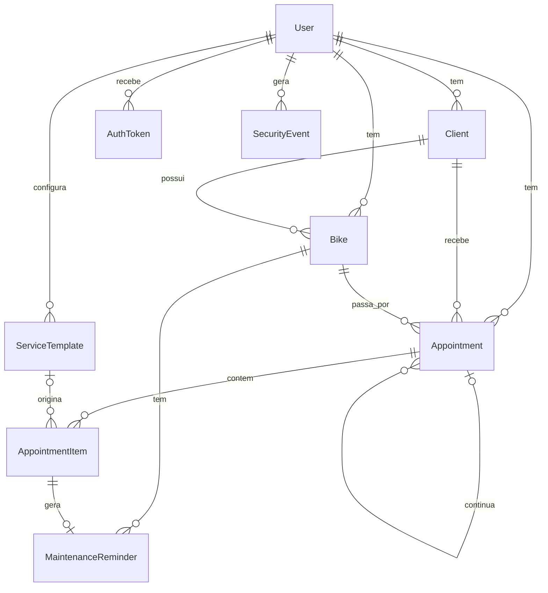

# Modelo de dados

São 5 tabelas novas e 4 alteradas, entregues em uma migration por fase. Dados existentes são preservados.

## Resumo

| Tabela | Nova / alterada | Fase | Mudança |
| --- | --- | --- | --- |
| `User` | alterada | 1, 2 | `tokenVersion`, `failedLoginCount`, `lockedUntil`, `isDemo`, `shopName`, `whatsappTemplate` |
| `Client` | alterada | 0 | `cpf` deixa de ser único global → `@@unique([userId, cpf])` |
| `Bike` | alterada | 2 | `type`, `currentOdometerKm`, `currentHours` |
| `Appointment` | alterada | 3 | `odometerKm`, `usageHours`, pagamento, vínculo com atendimento anterior |
| `AuthToken` | nova | 1 | códigos 2FA, tokens de reset, dispositivos confiáveis |
| `SecurityEvent` | nova | 1 | log de segurança |
| `ServiceTemplate` | nova | 2 | serviços padrão por oficina |
| `AppointmentItem` | nova | 3 | itens do atendimento (substitui `ServiceDetail`, hoje sem uso em telas) |
| `MaintenanceReminder` | nova | 3 | lembretes de revisão |

## Diagrama



## Rascunho do `schema.prisma`

Somente o que muda. Nomes de tabela seguem o padrão `@@map` em snake_case já usado.

```prisma
model User {
  // ...campos atuais
  shopName          String?
  whatsappTemplate  String?
  tokenVersion      Int       @default(0)
  failedLoginCount  Int       @default(0)
  lockedUntil       DateTime?
  isDemo            Boolean   @default(false)

  serviceTemplates  ServiceTemplate[]
  reminders         MaintenanceReminder[]
  authTokens        AuthToken[]
  securityEvents    SecurityEvent[]
}

model Client {
  // ...campos atuais, com:
  cpf  String?   // sem @unique

  @@unique([userId, cpf])
}

model Bike {
  // ...campos atuais
  type               BikeType?
  currentOdometerKm  Int?
  currentHours       Int?

  reminders          MaintenanceReminder[]
}

model Appointment {
  // ...campos atuais
  odometerKm           Int?
  usageHours           Int?
  paymentStatus        PaymentStatus  @default(PENDENTE)
  amountPaid           Float          @default(0)
  paymentMethod        PaymentMethod?
  paidAt               DateTime?
  parentAppointmentId  Int?
  linkType             AppointmentLinkType?

  parent    Appointment?  @relation("AppointmentChain", fields: [parentAppointmentId], references: [id])
  children  Appointment[] @relation("AppointmentChain")
  items     AppointmentItem[]
}

model ServiceTemplate {
  id                Int       @id @default(autoincrement())
  userId            Int
  key               String?   // identifica o serviço padrão de origem
  name              String
  category          ServiceCategory
  defaultLaborCost  Float
  estimatedMinutes  Int?
  intervalMonths    Int?
  intervalKm        Int?
  intervalHours     Int?
  active            Boolean   @default(true)
  createdAt         DateTime  @default(now())

  user       User               @relation(fields: [userId], references: [id])
  items      AppointmentItem[]
  reminders  MaintenanceReminder[]

  @@unique([userId, key])
  @@map("service_templates")
}

model AppointmentItem {
  id                 Int     @id @default(autoincrement())
  appointmentId      Int
  serviceTemplateId  Int?
  description        String
  laborCost          Float   @default(0)
  partsDescription   String?
  partsCost          Float   @default(0)

  appointment      Appointment      @relation(fields: [appointmentId], references: [id], onDelete: Cascade)
  serviceTemplate  ServiceTemplate? @relation(fields: [serviceTemplateId], references: [id])
  reminder         MaintenanceReminder?

  @@map("appointment_items")
}

model MaintenanceReminder {
  id                 Int             @id @default(autoincrement())
  userId             Int
  bikeId             Int
  appointmentItemId  Int             @unique
  serviceTemplateId  Int
  dueDate            DateTime?
  dueKm              Int?
  dueHours           Int?
  status             ReminderStatus  @default(ABERTO)
  contactedAt        DateTime?
  createdAt          DateTime        @default(now())

  user             User            @relation(fields: [userId], references: [id])
  bike             Bike            @relation(fields: [bikeId], references: [id])
  appointmentItem  AppointmentItem @relation(fields: [appointmentItemId], references: [id], onDelete: Cascade)
  serviceTemplate  ServiceTemplate @relation(fields: [serviceTemplateId], references: [id])

  @@index([userId, status, dueDate])
  @@map("maintenance_reminders")
}

model AuthToken {
  id         Int            @id @default(autoincrement())
  userId     Int
  type       AuthTokenType
  tokenHash  String         @unique
  expiresAt  DateTime
  usedAt     DateTime?
  attempts   Int            @default(0)
  createdAt  DateTime       @default(now())

  user  User  @relation(fields: [userId], references: [id], onDelete: Cascade)

  @@index([userId, type])
  @@map("auth_tokens")
}

model SecurityEvent {
  id         Int                @id @default(autoincrement())
  userId     Int?
  type       SecurityEventType
  ip         String?
  userAgent  String?
  createdAt  DateTime           @default(now())

  user  User?  @relation(fields: [userId], references: [id])

  @@index([userId, createdAt])
  @@map("security_events")
}

enum BikeType            { MTB SPEED URBANA EBIKE INFANTIL OUTRA }
enum ServiceCategory     { REVISAO TRANSMISSAO FREIOS SUSPENSAO RODAS OUTROS }
enum PaymentStatus       { PENDENTE PARCIAL PAGO }
enum PaymentMethod       { PIX DINHEIRO DEBITO CREDITO }
enum AppointmentLinkType { CONTINUACAO GARANTIA }
enum ReminderStatus      { ABERTO CONTATADO AGENDADO CONCLUIDO DISPENSADO }
enum AuthTokenType       { LOGIN_CODE PASSWORD_RESET TRUSTED_DEVICE }
enum SecurityEventType {
  LOGIN_SUCCESS
  LOGIN_FAILED
  ACCOUNT_LOCKED
  MFA_CODE_SENT
  MFA_FAILED
  PASSWORD_RESET_REQUESTED
  PASSWORD_CHANGED
  LOGOUT
}
```

## Migração de dados existentes

| Migration | Ação sobre dados atuais |
| --- | --- |
| Fase 0 — CPF por oficina | Recria o índice; nenhum dado muda |
| Fase 2 — serviços padrão | Insere os 18 `ServiceTemplate` para cada `User` existente |
| Fase 3 — itens | Para cada `Appointment` com `totalCost`, cria um `AppointmentItem` "Serviço avulso" com `laborCost = totalCost`; copia `ServiceDetail` existentes para `AppointmentItem`; depois remove `service_details`. Atendimentos antigos ficam com `paymentStatus = PAGO` se o status do serviço for `CONCLUIDO` |

`totalCost` continua existindo como valor calculado (soma dos itens), atualizado pelo serviço ao salvar, para não quebrar a API e facilitar as consultas do dashboard.

## Migrations no Turso (produção)

O Prisma não aplica migrations direto no libSQL remoto. Fluxo:

1. `npx prisma migrate dev --name <nome>` localmente (gera a pasta em `prisma/migrations/`).
2. `turso db shell <nome-do-banco> < prisma/migrations/<pasta>/migration.sql` para aplicar em produção.
3. Registrar no PR que a migration foi aplicada.
